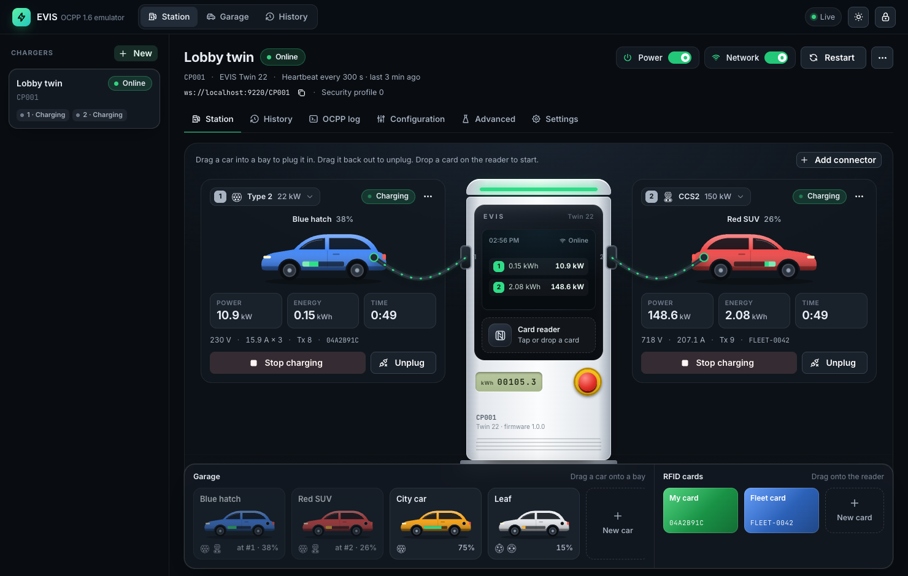

# EVIS OCPP Emulator

An OCPP 1.6-J charge point emulator with a visual station. Create chargers and
cars, drag a car to a connector to plug it in, tap a card, and watch a
transaction run against **your own CSMS** — with the messages, timing and
failure behaviour of a real charger.

Everything lives in one SQLite file. No database server to install.



## What it does

- **Chargers that look and act like chargers.** A screen, a card reader, status
  lights, an energy meter, an emergency stop, and a cable on each side.
- **Drag and drop.** Drag a car from the garage into a bay to plug it in, drag it
  out to unplug. Drop an RFID card on the reader to start or stop.
- **Any plug.** Type 1, Type 2, CCS1, CCS2, CHAdeMO, GB/T AC, GB/T DC, NACS and
  Schuko. Change a connector's type and power at any time; choose the car's
  charge port when you create it. A plug that does not fit is refused.
- **Your backend, your link.** Paste a `ws://` or `wss://` link. Optional
  password (HTTP Basic auth), TLS with your own CA or a self-signed certificate,
  and client certificates.
- **All of OCPP 1.6.** Core, Firmware Management, Local Auth List Management,
  Reservation, Smart Charging and Remote Trigger, plus the messages of the 1.6
  security extension. See [OCPP coverage](#ocpp-16-coverage).
- **History.** What every connector delivered, every session with its meter
  readings, a logbook per charger, and every OCPP frame.
- **Tools to test a CSMS.** Send any message by hand, make the charger answer
  wrongly, pull the network cable, cut the power, fault a connector.

## Quick start

You need Node.js 22 or newer, `pnpm` for the backend and `yarn` for the UI.

```bash
# 1. Backend: REST API, OCPP engine, SQLite  →  http://localhost:3000
cd back_end
pnpm install
pnpm start:dev

# 2. UI  →  http://localhost:5173
cd ../UI
yarn install
yarn dev
```

Open <http://localhost:5173>.

No CSMS at hand? Start the mock one that ships with the emulator and use
`ws://localhost:9220` as the link:

```bash
cd back_end
pnpm mock:csms
```

### With Docker

```bash
docker compose up
```

Backend on port 3000, UI on port 5173. The SQLite file is kept on the
`ocpp_data` volume; `docker compose down -v` deletes it.

## Your first session

1. **New charger.** Give it a charge point ID and the link of your CSMS. Leave
   "Power on and connect right away" on. The status pill turns to **Online**
   once the CSMS accepts the BootNotification.
2. **New car** in the garage at the bottom. Pick its charge port and battery.
3. **Drag the car** into a bay. The connector reports `Preparing`.
4. **Start charging**, or drop a card on the reader. The charger sends
   `Authorize`, then `StartTransaction`, and reports `Charging`.
5. **Stop** with the button or the card, then drag the car out. The connector
   goes `Finishing`, then `Available`.

A remote start from your CSMS works the same way: with the car plugged in the
transaction starts at once; without one the charger waits `ConnectionTimeOut`
seconds for the cable.

## Connecting to a CSMS

| Setting | What it does |
| --- | --- |
| CSMS link | `ws://…` or `wss://…`. `http(s)://` is read as `ws(s)://`. |
| Add the charge point ID to the link | On: dials `<link>/<chargePointId>`, as real chargers do. Off: dials the link exactly as pasted. |
| Password | Sent as `Authorization: Basic base64(<user>:<password>)`. It is the OCPP `AuthorizationKey`. |
| User name | Defaults to the charge point ID. |
| Check the server's certificate | Turn off to accept a self-signed certificate. |
| CA certificate | A private CA to trust for `wss://`. |
| Client certificate and key | For mutual TLS. |

The emulator shows the address it will dial before you save.

| Security profile | Link | Authentication |
| --- | --- | --- |
| 0 | `ws://` | none |
| 1 | `ws://` | password |
| 2 | `wss://` | password |
| 3 | `wss://` | client certificate |

A CSMS can change the password with `ChangeConfiguration(AuthorizationKey)`. The
charger then reconnects with the new password, as the security whitepaper asks.

## How a charger behaves

- **Boot.** BootNotification on connect. `Accepted` starts heartbeats at the
  interval the CSMS gave and reports the status of connector 0 and of every
  connector. `Pending` and `Rejected` are retried after the given interval, and
  the charger stays quiet meanwhile.
- **Status.** `Available → Preparing → Charging / SuspendedEV / SuspendedEVSE →
  Finishing → Available`, plus `Reserved`, `Unavailable` and `Faulted`.
- **Power.** The lowest of: the connector's rating, what the car accepts (an
  on-board charger limited per phase on AC, a tapering curve on DC) and the
  smart-charging limit. Below 6 A per phase a car does not charge.
- **Meter.** Each connector has a lifetime energy register. MeterValues go out
  every `MeterValueSampleInterval` seconds with the measurands in
  `MeterValuesSampledData`; clock-aligned values and `StopTxnSampledData` are
  supported.
- **Offline.** Pull the network cable and the charger keeps working.
  Authorization falls back to the local list and the cache. StartTransaction,
  MeterValues and StopTransaction are queued on disk and delivered in order
  when the link is back, with the timestamps of when they happened.
- **Power loss.** Cut the power, or kill the emulator: running transactions are
  reported with reason `PowerLoss` after the next boot.
- **Full battery.** An AC connector idles in `SuspendedEV`; a DC connector ends
  the transaction. Both can be changed per charger.
- **Speed.** Charging can run 5×, 20× or 60× faster than the clock, so a battery
  fills in minutes.

## OCPP 1.6 coverage

| Profile | Charger → CSMS | CSMS → charger |
| --- | --- | --- |
| Core | Authorize, BootNotification, DataTransfer, Heartbeat, MeterValues, StartTransaction, StatusNotification, StopTransaction | ChangeAvailability, ChangeConfiguration, ClearCache, DataTransfer, GetConfiguration, RemoteStartTransaction, RemoteStopTransaction, Reset, UnlockConnector |
| Firmware Management | DiagnosticsStatusNotification, FirmwareStatusNotification | GetDiagnostics, UpdateFirmware |
| Local Auth List Management | | GetLocalListVersion, SendLocalList |
| Reservation | | ReserveNow, CancelReservation |
| Smart Charging | | SetChargingProfile, ClearChargingProfile, GetCompositeSchedule |
| Remote Trigger | | TriggerMessage |
| Security extension | SecurityEventNotification, SignCertificate, LogStatusNotification, SignedFirmwareStatusNotification | ExtendedTriggerMessage, CertificateSigned, InstallCertificate, GetInstalledCertificateIds, DeleteCertificate, GetLog, SignedUpdateFirmware |

All standard configuration keys are present with their read-only or read-write
status, and you can add vendor keys. Requests are checked before they are acted
on: a malformed one gets a CALLERROR, an unknown action `NotImplemented`.

### What is simulated, not real

- **Firmware and diagnostics files** are not transferred. The charger sends the
  status notifications of a real update (including the reboot into the new
  version) or upload, and you can make either fail.
- **The signature of a signed firmware update** is not verified.
- **Certificates** are stored and used for TLS, but chains are not validated
  beyond matching a signed certificate to the key the charger generated.
- **ISO 15118 / Plug & Charge** is not implemented. "Start when a car is plugged
  in" authorizes the charger's default idTag instead.
- OCPP 2.0.1 and OCPP 1.6 over SOAP are not supported.

## History and storage

Everything is in one SQLite file, `back_end/data/emulator.sqlite` by default
(`SQLITE_PATH` moves it). You can open it with any SQLite tool.

| Table | Holds |
| --- | --- |
| `charge_points`, `connectors` | Chargers and their connectors, including each connector's lifetime meter |
| `cars`, `id_tags` | Cars and RFID cards |
| `charging_sessions`, `meter_samples` | Every transaction and its readings |
| `charger_events` | The logbook: boots, plug events, faults, CSMS commands |
| `ocpp_logs` | Every OCPP frame (the newest 3 000 per charger are kept) |
| `reservations`, `charging_profiles`, `auth_entries` | What the CSMS installed on the charger |
| `queued_messages` | Transaction messages waiting for the CSMS |

Deleting a charger deletes its history with it.

## Testing tools

In a charger's **Advanced** tab:

- **Send a message to the CSMS.** Any charger-to-CSMS request, with a payload you
  can edit. The fields are filled with live values.
- **Wrong answers.** Make the charger answer a CSMS request with another status,
  a CALLERROR, or not at all — once or every time.
- **Things that go wrong.** A firmware download or installation that fails, an
  upload that fails, a jammed connector lock.
- **Inside the charger.** The offline queue, reservations, charging profiles,
  the local authorization list and the authorization cache.

On the station itself: the **Network** switch, the **Power** switch, **Restart**,
the emergency stop, and "Report a fault" in each connector's menu.

## Configuration

Copy `.env.example` to `.env` to change a default.

| Variable | Default | Description |
| --- | --- | --- |
| `PORT` | `3000` | Backend port |
| `SQLITE_PATH` | `data/emulator.sqlite` | The database file. `:memory:` keeps nothing. |
| `JWT_SECRET` | `dev-secret-change-me` | Signs logins once the instance is locked |
| `JWT_EXPIRES_IN` | `7d` | How long a login lasts |
| `VITE_API_URL` | `http://localhost:3000/api` | Where the UI finds the backend |
| `VITE_WS_URL` | the backend's origin | Where the UI gets live updates |

The emulator is open by default. The lock button in the top bar creates one
account; from then on the API and the UI need a login.

## Project structure

```
.
├── back_end/                 NestJS API and the OCPP engine
│   ├── src/engine/           The emulator itself
│   │   ├── virtual-charge-point.ts   One charger: connection, status, transactions
│   │   ├── csms-requests.ts          Every request a CSMS can send
│   │   ├── firmware.ts               Firmware, diagnostics and log uploads
│   │   ├── engine.ts                 All chargers and cars, and the clock
│   │   ├── ocpp16/                   Config keys, validation, smart charging, meter
│   │   ├── rpc/                      OCPP-J over WebSocket
│   │   └── sim/                      How a car takes power
│   ├── src/api/              REST controllers
│   ├── src/entities/         The SQLite tables
│   ├── test/                 End-to-end tests against a mock CSMS
│   └── tools/mock-csms.ts    A stand-in CSMS
├── UI/                       React + Vite + Mantine
│   └── src/station/          The charger scene, bays, cables and tabs
└── docker-compose.yml
```

## Development

```bash
cd back_end
pnpm test          # every OCPP profile, offline behaviour, TLS and the REST API
pnpm lint
pnpm build

cd ../UI
yarn lint
yarn build
```

The tests start a mock CSMS and real WebSocket connections; the TLS tests need
the `openssl` command.

### The mock CSMS

`pnpm mock:csms` accepts any charge point on `ws://localhost:9220/<id>` and
answers with sensible defaults. `--password <pw>` requires Basic auth. A small
HTTP API on port 9221 lets you play the CSMS from a terminal:

```bash
# What is connected, and what the chargers sent
curl localhost:9221/chargers
curl "localhost:9221/messages?action=MeterValues"

# Send a request to a charger; the JSON body is the payload
curl -X POST localhost:9221/call/CP001/RemoteStartTransaction \
     -H 'content-type: application/json' -d '{"connectorId":1,"idTag":"APP"}'
```

### REST API

The UI uses the same API you can script against, under `/api`.

| | |
| --- | --- |
| `GET/POST /charge-points`, `GET/PATCH/DELETE /charge-points/:id` | Chargers |
| `POST /charge-points/:id/power`, `/network`, `/reboot`, `/emergency-stop` | Switches |
| `POST /charge-points/:id/rfid` | Tap a card: `{ "idTag": "…", "connectorId": 1 }` |
| `POST /charge-points/:id/connectors`, `PATCH …/connectors/:n` | Add or change a connector |
| `POST …/connectors/:n/plug`, `/unplug`, `/stop`, `/fault`, `/pause` | At the connector |
| `GET/PUT /charge-points/:id/configuration` | OCPP configuration keys |
| `POST /charge-points/:id/ocpp/call` | Send any request to the CSMS |
| `GET /charge-points/:id/history`, `/events`, `/logs`, `/internals` | What happened |
| `GET/POST/PATCH/DELETE /cars`, `POST /cars/:id/battery` | Cars |
| `GET/POST/PATCH/DELETE /id-tags` | RFID cards |
| `GET /sessions`, `GET /sessions/:id` | Transactions and their readings |

Live updates arrive over Socket.IO on the backend's port.

## License

Open source — license TBD.
